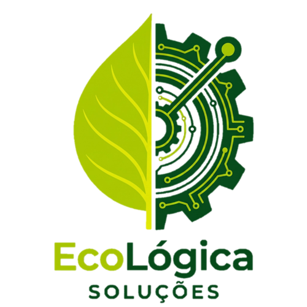

  

# 🍃 EcoLógica Soluções

Site acadêmico (10 páginas, HTML5 + CSS3 + JavaScript) sobre **Sustentabilidade e Impacto Social**: consultoria fictícia em energia limpa e acessibilidade para pessoas com deficiência.
Disciplina Desenvolvimento Front-End - Fatec São Caetano do Sul - Atividade A06.

* **Site publicado (Railway):** https://ecologica-solucoes-production.up.railway.app
* **Repositório:** https://github.com/JeehSilphis/EcoLogica-Solucoes-
* **Equipe:** Jéssica da Silva Soares

📑 Documentação completa (objetivos, divisão de funções, diário de bordo, orçamento, testes e relatório de melhorias) na pasta [`docs/`](docs/README.md).
