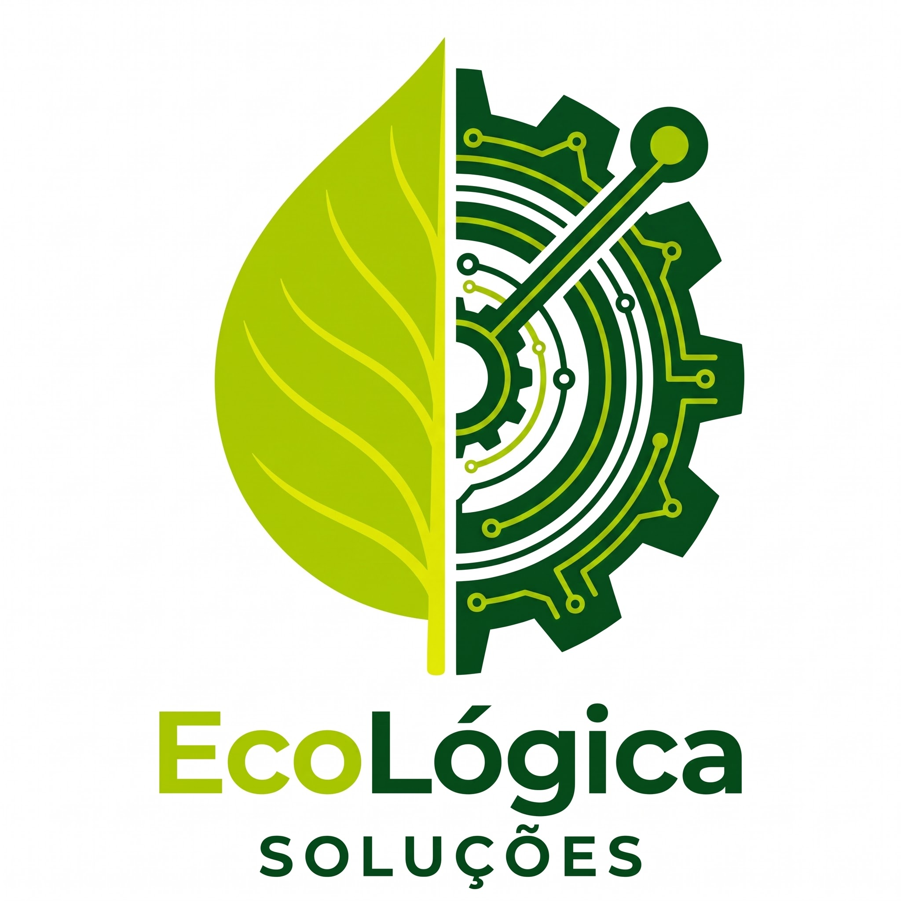

  

# 🍃 EcoLógica Soluções

Projeto acadêmico desenvolvido para a disciplina de Desenvolvimento Web da Fatec São Caetano do Sul - Antonio Russo. Trata-se da criação de um site MVP (Minimum Viable Product) para uma empresa fictícia de consultoria em energia sustentável.

## 🎯 Tema
**Sustentabilidade e Impacto Social**. 
O projeto foca na transição para um consumo energético mais eficiente e responsável (energias renováveis e eficiência energética), promovendo impacto social através do consumo consciente e preservação ambiental.

## 🚀 Objetivos
* Desenvolver um site MVP completo com 10 páginas interligadas em HTML5 e CSS3.
* Garantir 100% de acessibilidade web, priorizando a inclusão de pessoas com deficiência (PCD) na navegação do site.
* Aplicar estruturação semântica de código validada pelo W3C Validator.
* Conscientizar o público-alvo (empresas e residências) sobre a importância da energia limpa e os benefícios da redução do desperdício energético.

## 🛠️ Tecnologias Utilizadas
* **HTML5:** Estruturação semântica (`<header>`, `<nav>`, `<main>`, `<section>`, `<footer>`) e validação de formulários nativa.
* **CSS3:** Estilização com foco em responsividade (Media Queries) e alto contraste para acessibilidade.
* **Railway:** Plataforma all-in-one inteligente utilizada para o deploy e hospedagem em nuvem do projeto, garantindo SSL automático e escalabilidade.

## 👥 Divisão de Funções da Equipe
Para o desenvolvimento deste MVP, as tarefas foram divididas da seguinte forma:

* **Jéssica da Silva Soares:** Estruturação HTML da Home, estilização CSS, adaptação da identidade visual (logotipo) e elaboração do Escopo do Projeto.

## 📂 Estrutura do Projeto
A estrutura de pastas e arquivos segue o padrão exigido

